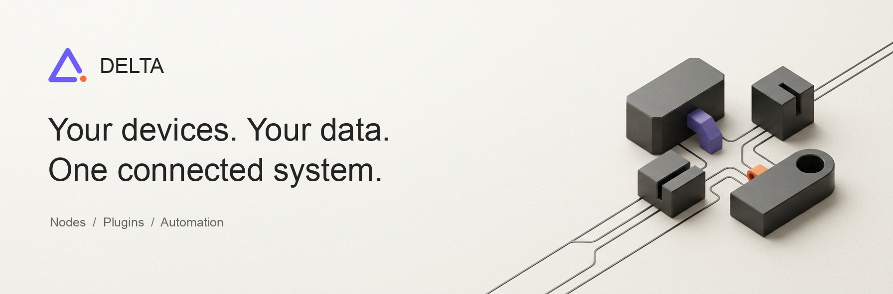
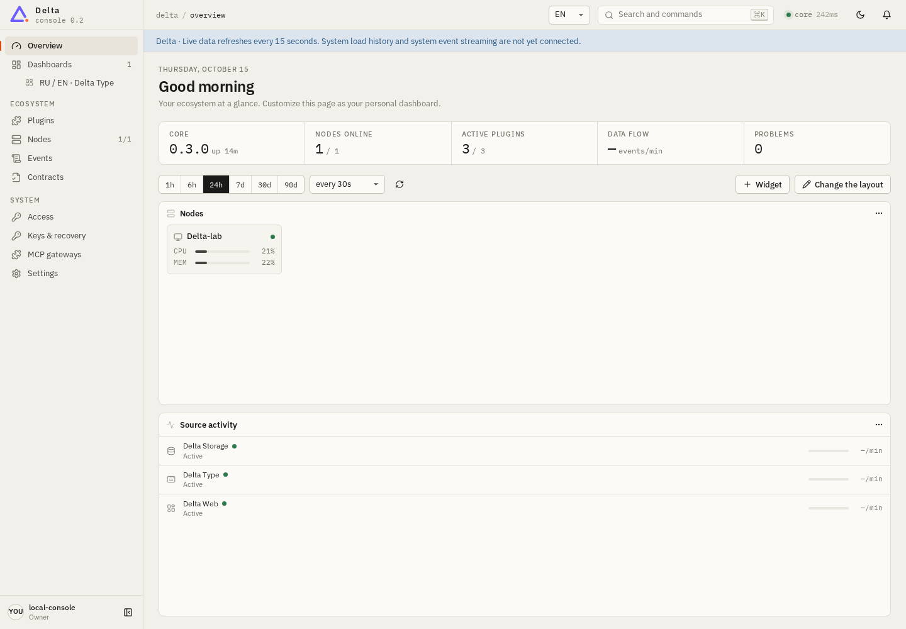
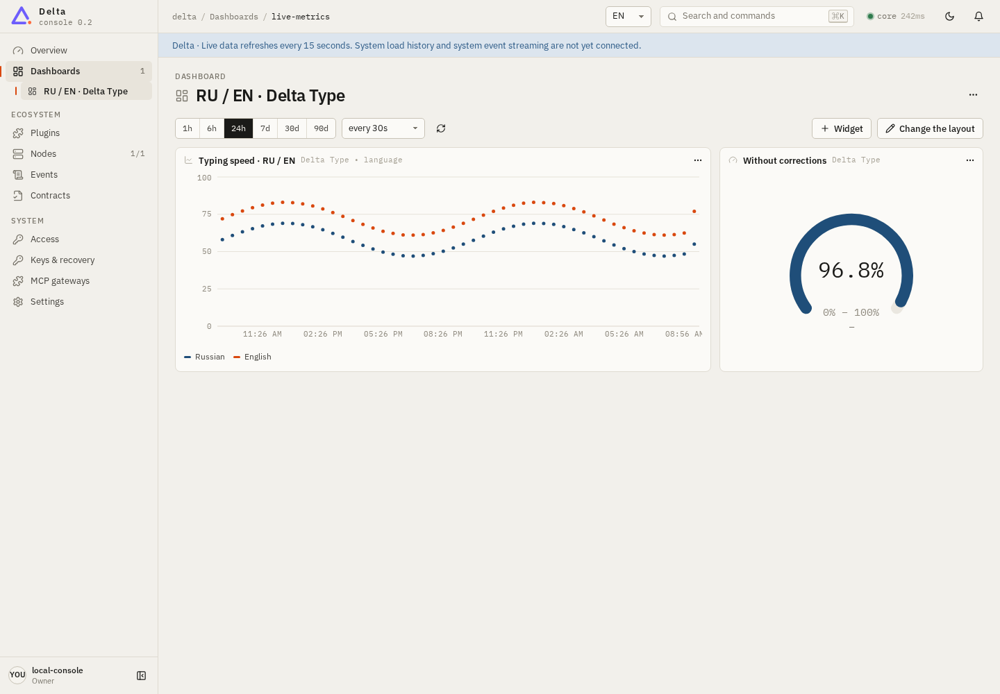

# Delta

**A personal, modular system for your devices, data and automation.**

Delta connects your desktop, phone and VPS into one self-hosted system. A small Rust node handles identity, routing and trust; the web console, storage and data sources are independent plugins you can replace without rebuilding the core.

[Quick start](#quick-start) · [Interfaces](#choose-your-interface) · [Architecture](#how-it-works) · [Security](#security-and-access) · [Develop](#develop) · [Docs](#documentation)

> Early release. Back up your data before upgrades. Delta is self-hosted: there is no hosted account, NAT relay or VPN.

## What you get

- **One control room** for all your nodes: dashboards, device health, component versions and supervisor logs.
- **Plugins from pinned releases:** install official plugins from the store; every download is version-pinned and SHA256-checked.
- **Scoped access:** capability tokens, key-based sign-in (BIP340/Schnorr) and explicit, directional trust between paired nodes.
- **AI access on your terms:** independent MCP gateways with a tool allow-list per profile.
- **English / Russian** across the console and plugin presentation.





Real browser captures against a local test node; the typing history is generated aggregate data, not captured text. The screenshots show an earlier console version.

## Choose your interface

All interfaces share the same UI ([delta-ui](https://github.com/n-ycta/delta-ui)). Service features stay independent plugins.

| Interface | Use it for | Install |
| --- | --- | --- |
| Browser / VPS | The full console on a server or desktop | [Quick start](#quick-start) (node + storage + web) |
| Desktop (Linux, Windows) | A native app with an embedded node; no web plugin needed | [delta-desktop](https://github.com/n-ycta/delta-desktop#install-the-latest-release) |
| Android | A phone as a node and console; desktop-only plugin capabilities come from a paired trusted node | [Latest APK](https://github.com/n-ycta/delta-android/releases/latest/download/Delta-Android-arm64-x86_64.apk), see [delta-android](https://github.com/n-ycta/delta-android) |

Desktop and Android are preview hosts, not full replacements for the web console.

## Quick start

No Rust compiler, Git clone or manual token paste. The installer downloads a prebuilt node, a private Node.js runtime and verified plugin releases. Default: **node + storage + web**.

**Linux · x64 / ARM64** (needs curl, tar with xz, sha256sum):

```sh
curl -fsSL https://raw.githubusercontent.com/n-ycta/delta/main/install.sh -o delta-install.sh
sh delta-install.sh
```

**Windows · x64** (PowerShell, normal user):

```powershell
Invoke-WebRequest https://raw.githubusercontent.com/n-ycta/delta/main/install.ps1 -OutFile delta-install.ps1
.\delta-install.ps1
```

Read the script before running it. Internet access to GitHub, nodejs.org and npm is needed during setup.

Choose what to install:

```sh
sh delta-install.sh --choose                   # interactive (PowerShell: -Choose)
sh delta-install.sh --plugins storage,web,typing   # (PowerShell: -Plugins storage,web,typing)
sh delta-install.sh --plugins none             # bare node, no web UI
```

The console opens at **http://127.0.0.1:7710** with a one-use setup link (valid five minutes; re-run with `--open` / `-Open` for a new one). Save and enroll a recovery key during that first session. On a headless VPS the installer prints an SSH-tunnel command instead. Public owner registration is disabled.

Linux installs a systemd **user** service; Windows installs a current-user sign-in launcher, not a Windows service. Details, repair and troubleshooting: [operations notes](docs/operations.md), [repair](docs/repair.md), [access recovery](docs/recover-access.md).

### Add another device

In the console open **Nodes → Add device**, enter the reachable hub and new-device URLs, pick Linux or Windows and run the generated short-lived command on the new machine. The checkbox **Allow this hub to install and manage plugins** is an explicit, one-way trust decision; without it pairing grants normal capability calls only. Peers do not forward calls to a third node.

Reach nodes over a VPN (for example WireGuard) or an authenticated HTTPS reverse proxy. The node serves plain HTTP; never expose an unprotected port to the Internet.

## How it works

```text
 browser / desktop / Android  ──  shared UI (delta-ui)
              │
        delta node (Rust): identity · capability routing · authorization · peers · supervisor · package installer
              │  POST /v1/call {capability, args, node?}
   ┌──────────┼───────────┬────────────┬──────────────┐
  web      storage      mcp        updater     provision · observability   (independent plugin processes)
```

- The core owns identity, routing, authorization, peer transport, process supervision and verified package installation. Plugins are separate processes that register declarative capabilities over the external-component protocol.
- Storage is a plugin: local files for a quick start, or PostgreSQL/TimescaleDB. File mode is limited to 100,000 records.
- Node-to-node calls are HMAC-signed. Pairing gives capability routing, not data replication.
- Contracts, files and ports: [platform guide](docs/platform.md); plugin dependencies: [dependency contracts](docs/dependencies.md).

| Plugin | Purpose |
| --- | --- |
| [delta-web](https://github.com/n-ycta/delta-web) | Browser host, sessions, shared UI compatibility facade |
| [delta_db](https://github.com/n-ycta/delta_db) | Record/document storage; files or PostgreSQL + TimescaleDB |
| [delta_type](https://github.com/n-ycta/delta_type) | Opt-in RU/EN typing aggregates; never records typed text |
| [delta-mcp](https://github.com/n-ycta/delta-mcp) | Headless HTTP MCP gateways and scoped profiles |
| [delta-updater](https://github.com/n-ycta/delta-updater) | Release checks, schedules and update jobs |
| [delta-provision](https://github.com/n-ycta/delta-provision) | SSH onboarding and connection lifecycle |
| [delta-observability](https://github.com/n-ycta/delta-observability) | Observed events, telemetry sampling and metric queries |

The store reads [the official index](registry/plugins.json). Archives reject links and path traversal, npm lifecycle scripts are disabled, and a failed readiness check restores the previous supervisor configuration. Plugins run native code with your OS permissions: **this is not a sandbox**. Review requested scopes and trust the publisher. Only owners or explicitly trusted administrative peers can install code.

## Security and access

- Setup exchanges a short-lived one-use code for an HttpOnly, SameSite=Strict session; the owner token never appears in a URL or script response.
- Tokens carry explicit capability scopes and optional expiry. A `call:*` token cannot run administrative commands.
- **Keys & recovery:** enroll an x-only secp256k1 public key; login signs an origin-bound, expiring, single-use challenge. Accepts raw private-key hex, Nostr `nsec` or a generated English BIP39 phrase (Delta-specific derivation, no relay account). Private keys never leave the browser; keep recovery material offline. Revoking a key revokes its sessions.
- Key login defaults to localhost origins; for a custom HTTPS origin add it to `identity_origins` and set a matching `PUBLIC_ORIGIN` on the web process.
- MCP gateways each get a separate bearer credential and kernel token, explicit tools, node/plugin limits and field redaction. Token management, shell execution and package installation are excluded from the MCP catalog.
- Never publish `admin.token`, `.env`, `config.json`, session files or MCP credentials. Full model: [platform guide](docs/platform.md).

## Develop

```sh
cargo test --locked
cargo build --release --locked
node --test tests/installer.test.mjs   # installer port selection and stale-reuse checks
```

Release binaries and the package index are rebuilt and versioned together; editing source does not update an installed prebuilt runtime. CI tests Linux and Windows; assets target Linux x64/ARM64 (musl) and Windows x64. There is no one-command prebuilt installer for macOS.

Working on plugins or the console from source: [local source development](docs/ecosystem.md).

## Documentation

[Platform and operations](docs/platform.md) · [Installation notes](docs/operations.md) · [Dependency contracts](docs/dependencies.md) · [Repair](docs/repair.md) · [Recover access](docs/recover-access.md) · [Local development](docs/ecosystem.md) · [Verification report](docs/verification.md)

Licensed under [Apache 2.0](LICENSE).
